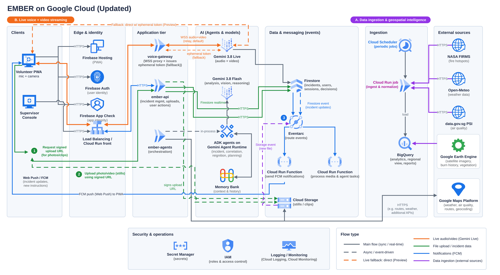
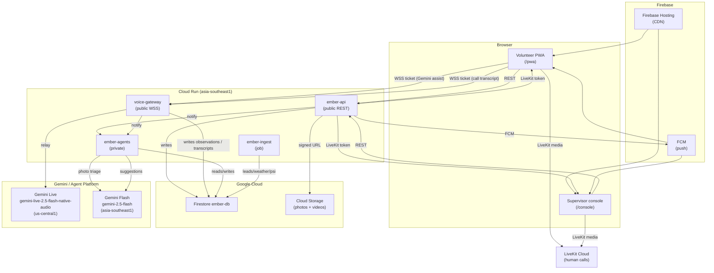
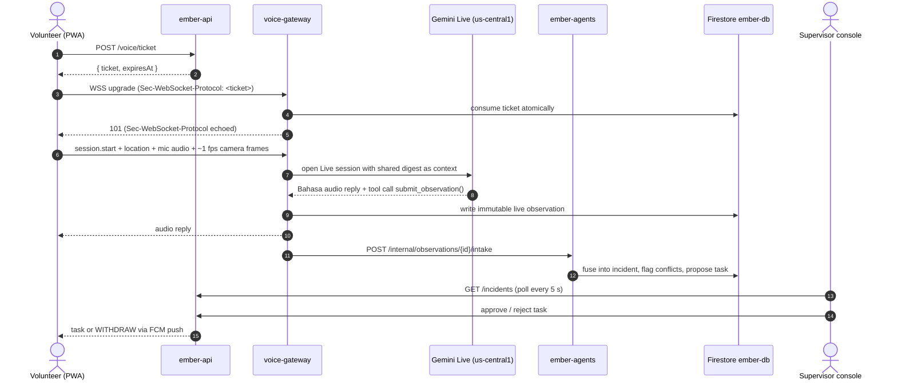

# EMBER: Many eyes, one fire

**A Bahasa-first voice and camera AI fire commander for village volunteer firefighters in Sumatra and Kalimantan. Several volunteers' phones feed one shared incident, and a human supervisor approves every high-stakes call.**


> Built for the **Google Cloud AI Builder Cup 2026**.
> **Status (19 Oct 2026):** infrastructure is live in `asia-southeast1`, defined in Terraform, and all six deploy pipelines run on demand. Application code is shipped and deployed. Supervisor-initiated LiveKit calls with shared transcription are built; they are switched on through deployment configuration (the `livekit_url` Terraform variable plus the `LIVEKIT_API_KEY` and `LIVEKIT_API_SECRET` secret values), and the committed `infra/terraform/terraform.tfvars` leaves `livekit_url` empty. Items marked *partial* or *not built* below are stubs or planned future work.

---

## Quick links

| | |
|---|---|
| **Live app** | [ember-fire-commander.web.app](https://ember-fire-commander.web.app) |
| **Demo video (3–4 min)** | [Demo video (3–4 min)](LINK_TBD) |
| **Pitch deck** | [Pitch deck (PDF)](LINK_TBD) |

---

## 30-second pitch

Village fire brigades in Indonesia's peatlands are unpaid volunteers on motorbikes. Each day they face thousands of satellite hotspots and can only reach a handful. EMBER gives each volunteer a hands-free, Bahasa-speaking AI commander — press and hold to talk, show the fire on camera, and get guidance back in seconds. Records are clipped to video and stored with voice audio. Reports from many phones are fused into **one shared incident picture** for a human supervisor, who sees photos and video clips, resolves conflicts, and approves dispatch. When there is no data connection, the app opens a pre-filled SMS draft in the phone's own messaging app. The volunteer still has to send it, and sending needs cell signal. Supervisors sign in through a web console, no app store needed.

The one rule that can never wait for approval — **WITHDRAW upwind** — is written in deterministic code. It fires immediately on large flames or high wind, before any model reply.

EMBER helps scarce brigades decide **where to look first**. It does **not** forecast fire spread or haze, and it does not stop haze.

## The problem

- About **202,000 ha burned in Indonesia from January to July 2026**, with West Kalimantan worst hit. The forestry minister said fires could last until early November. ([Reuters, Sep 2026](https://www.reuters.com/investigates/special-report/asia-weather-indonesia-wildfire-women/))
- Groups like **the Power of Mama** — more than 140 women patrolling 10 villages in Ketapang — work unpaid on motorbikes. They record hotspots and put out fires. Peat fires "smoulder underground" and come back.
- NASA FIRMS satellite hotspots are thermal anomalies, not confirmed fires, and NASA says FIRMS is not meant for tactical decisions. Someone on the ground has to verify them, and there are few volunteers to do it.

## How it works

1. **Leads:** every hour, NASA FIRMS hotspots and weather are pulled in. Each hotspot is a **lead to verify**, labelled `unverified_lead`. They are never called fires.
2. **Report:** a volunteer presses push-to-talk on the Bahasa-first PWA and speaks to the AI voice coach while the live camera streams frames. Or they tap a quick chip (*asap*, *api*, *aman*, *butuh bantuan*), type a note, attach up to four photos and one video clip (from Report or Task), or record a short video (up to 60 s). See [docs/demo/report-uploads.md](docs/demo/report-uploads.md).
3. **Fuse:** `ember-agents` merges reports, photos, video clips, positions, and satellite leads from several volunteers into one incident with a transparent evidence score.
4. **Conflicts are surfaced:** if volunteers disagree ("small flame" vs "no flame"), EMBER flags it, shows both side by side, and holds dispatch.
5. **Human approves:** the supervisor console shows the shared picture, a verification queue, wind, and an *indicative* downwind exposure corridor. The supervisor approves, edits, or rejects each proposal. Only a human can verify or extinguish an incident or lower its severity.
6. **Safety first:** deterministic rules in code (not model output) send **WITHDRAW upwind** on large flames or high wind, immediately and logged, with no approval needed.
7. **Re-ignition watch:** extinguished sites are remembered. New detections near them raise a re-inspection alert in the supervisor console.

## Key features as they exist today

### Volunteer PWA (`/pwa`)

- **Sign in / create account:** Google sign-in registers a roleless Google account as a volunteer through `POST /volunteers/register`. Onboarding collects crew, phone, and language preference.
- **Home screen:** nearby incidents (from FIRMS leads and verified reports), current tasks, and a quick-report shortcut.
- **Report screen:** chip row (`asap` / `api` / `aman` / `butuh bantuan`), free-text note, **live camera preview**, photo capture, **video clip recording** (up to 60 s, 500 kbps; audio mixed from the push-to-talk microphone), and an offline outbox that replays in order when connectivity returns.
- **Push-to-talk voice coach:** press and hold to open a Gemini Live session. The live camera frames stream alongside the audio. The coach replies in Bahasa, and tool calls write immutable observations. The microphone stream is reused for video recording so the user is not asked twice.
- **Incident detail:** full observation history, task card, nearby co-reporters.
- **Task screen:** accept, decline (with reason selection), or flag a task.
- **WITHDRAW flow:** full-screen safety instruction with reason, confirm-safe step, and a clear screen once the supervisor marks the volunteer safe.
- **SMS fallback screen:** when signal is lost, a pre-built message (help / safe / spreading) opens as a draft in the phone's own SMS app, addressed to the crew lead or duty line numbers configured by the supervisor. EMBER does not send the SMS: the volunteer sends it, and that still needs cell signal.
- **Guided AI learning (Guide screen):** a training video, scenario lessons with three-check quizzes, and a grounded Gemini Flash practice coach. Progress is saved per volunteer.
- **Profile screen:** name, crew, phone, language, location-sharing preference.
- **Incidents list:** past and current incidents the volunteer has reported on.

### Supervisor console (`/console`)

- **Sign in / create account:** Google sign-in with `POST /supervisors/register` (self-registration). No invitation code needed.
- **Incident queue:** live-updating list of open, held, and verified incidents.
- **Incident detail — two-pane expanded view:** left pane shows the incident timeline, observations, conflict, and AI-generated suggestions (via Gemini Flash). Right pane is the **expanded volunteer view**, showing a selected volunteer's reports, device stats, and most recent photos and video clip.
- **Live panel — recorded clips:** the expanded volunteer view shows the most recent uploaded video clip alongside photo snapshots.
- **Decline reasons:** when a volunteer declines a task, the reason appears in the expanded view.
- **Supervisor decision panel:** approve, edit, or reject proposed tasks. Send withdraw to specific volunteers.
- **Withdraw confirmation:** tracks how many volunteers have confirmed safe.
- **Map page:** all incident locations on a Google Map.
- **Approvals page:** pending join requests.
- **Audit log:** every supervisor action with actor, time, and target.
- **Re-ignition alert banner:** new activity near an extinguished site prompts a recheck or dismiss.
- **Supervisor live call:** the incident popup has a **Request live video** button. The volunteer receives a foreground or FCM invitation and can Join or Decline (expires in 45 seconds). Once accepted, LiveKit carries volunteer camera and audio; the supervisor publishes microphone only. Both participants see a shared ordered call transcript driven by Gemini transcription. The supervisor can save JPEG snapshots to the incident and ask Gemini questions with call context. See [docs/demo/livekit-test.md](docs/demo/livekit-test.md).
- **Test connectivity (Profile):** volunteers can claim a `CALL-XXXX-XXXX` test code for hackathon two-device verification without an incident.

### Voice coach

- **Model:** `gemini-live-2.5-flash-native-audio` on Agent Platform, `us-central1` (no Asia endpoint yet).
- **Authentication:** the PWA calls `POST /voice/ticket` to get a 60-second single-use ticket, then opens `new WebSocket(url, [ticket])`. The gateway reads the ticket from `Sec-WebSocket-Protocol`, verifies it atomically from Firestore, and echoes the subprotocol back in the 101 response (required by browsers).
- **Tools the model may call:** `submit_observation` (severity, text), `get_common_picture` (the caller's digest), `get_my_task` (newest approved task, withdraw preferred).
- **Caps:** 10 min per user, 60 min per operation (counted per Cloud Run instance; a reconnect does not reset).
- **Push-to-talk bursts:** a session opens on button press, uses manual activity detection so wind and engine noise do not trigger it, and closes about 30 s after the reply.

### Agents (`ember-agents`)

- **Intake:** `POST /internal/observations/{id}/intake` — clusters the observation into the nearest matching incident or creates a new one, computes the evidence score, detects conflicts, and fires WITHDRAW when rules trigger.
- **Spotter:** `POST /internal/observations/{id}/triage` — Gemini Flash reads the photo and returns `smokeVisible`, `flameVisible`, `burnScarVisible`, `notes`, `confidence`.
- **Assist:** `POST /internal/incidents/{id}/suggestions`, `/ask`, `/observations/{id}/translate` — Gemini Flash advisory for the supervisor; never changes incident state.
- **Summary:** `POST /internal/incidents/{id}/summary` — Bahasa/English incident summary for the supervisor.
- **Practice coach:** `POST /internal/practice` — grounded Gemini Flash quiz and conversation for the Guide screen.
- **Sites scan:** `POST /internal/sites/scan` — re-ignition watch (run by Cloud Scheduler).

### Ingest (`ember-ingest`)

Hourly Cloud Run job. Pulls NASA FIRMS hotspots, Open-Meteo weather, and data.gov.sg PSI. Writes to `leads/`, `weather/current`, and `psi/current` in Firestore. Never writes incidents or severities.

---

## Architecture



Editable source: [`docs/architecture/ember_infra_v2.drawio`](docs/architecture/ember_infra_v2.drawio). Full architecture notes: [`docs/architecture/architecture.md`](docs/architecture/architecture.md). The diagram above predates the LiveKit call path; the Mermaid view below reflects the current full picture.



Photo and video bytes go directly to Cloud Storage via a **signed URL** issued by `ember-api`. Human call media flows through LiveKit using room-scoped tokens issued by `ember-api`. The browser never opens Firestore listeners and never calls Gemini directly. The only Google API it calls itself is the Maps JavaScript API, for map tiles. Firestore and Storage rules are deny-all.

Full component table:

| Component | Runs on | What it does |
|---|---|---|
| Volunteer PWA + supervisor console | Firebase Hosting | One React/Vite/TS app with role-based routes. Push-to-talk, camera, video recording, chips, task cards, WITHDRAW flow, SMS fallback, Guide screen, supervisor decision panel, expanded volunteer view, live panel, LiveKit calls with shared transcript |
| `ember-api` (public) | Cloud Run | REST: auth, roles, signed upload URLs (photos + video), approvals, incidents, digest, dashboard, training, practice relay, FCM push, audit log, voice tickets, call lifecycle, scoped LiveKit tokens |
| `voice-gateway` (public, WSS) | Cloud Run | Verifies voice ticket via `Sec-WebSocket-Protocol`, relays audio and ~1 fps camera frames to Gemini Live, enforces Live-minute caps, writes observations from tool calls, notifies agents, delivers shared call transcription |
| LiveKit Cloud | LiveKit | Volunteer video and two-way call audio; supervisor publishes microphone only. Room-scoped tokens issued by `ember-api` |
| `ember-agents` (private) | Cloud Run | Python service that calls Gemini through the google-genai SDK: intake, fusion, conflict detection, evidence scoring, WITHDRAW rules, Spotter (photo triage), Assist (suggestions/ask/translate/call-frame), Summary, Practice coach, Sites scan |
| `ember-ingest` | Cloud Run job + Scheduler | Hourly FIRMS hotspots, weather (Open-Meteo), and PSI (data.gov.sg) |
| Firestore `ember-db` | Firestore Native | Shared incident state. Client access is deny-all |
| Cloud Storage | Cloud Storage | Private bucket: photos (14-day lifecycle), videos (7-day lifecycle). Signed-URL access only |

### Supervisor-to-volunteer calls

The supervisor opens a volunteer's incident popup and selects **Request live video**. The volunteer receives a push notification or foreground invitation and can **Join** or **Decline** (expires after 45 seconds). Once accepted, LiveKit carries volunteer video and two-way audio; both participants can mute. Each participant's unmuted microphone reaches Gemini through `voice-gateway /calls/transcription`; both screens see the same shared ordered transcript. The supervisor can explicitly save JPEG snapshots to the incident. AI questions and suggestions receive bounded recent transcript and visual context. Live call media is not automatically recorded.

For hackathon testing, a volunteer can claim a `CALL-XXXX-XXXX` code via **Profile → Test Connectivity** without needing an active incident. See [`docs/demo/livekit-test.md`](docs/demo/livekit-test.md).

### Voice and video path



---

## How we use Gemini and Google Cloud AI

| Model / service | Used for |
|---|---|
| **Gemini Live** (`gemini-live-2.5-flash-native-audio`, `us-central1`) | Bahasa voice and camera conversation per push-to-talk burst. Tool calls `submit_observation`, `get_common_picture`, `get_my_task`. The model never changes incident state. Also used for per-speaker call transcription via `voice-gateway /calls/transcription` |
| **Gemini Flash** (`gemini-2.5-flash`, `asia-southeast1`) | Photo triage (Spotter), Bahasa/English incident summaries, supervisor suggestions, report translation, grounded practice coach, call-frame visual descriptions |
| **Agent Platform** | Service-account auth for both model calls. No Gemini API key on the deployed path |

Design principle: **deterministic code decides, Gemini talks and looks.** Distances, wind, scores, and safety rules come from code and data. Every number spoken or shown to a volunteer comes from a tool return value or a Firestore-stored field. Gemini never sets incident severity, tasks, or WITHDRAW.

---

## Google Cloud services used

| Service | Why |
|---|---|
| Cloud Run (`ember-api`, `voice-gateway`, `ember-agents`, `ember-ingest`) | Serverless containers. WebSocket support (3600 s timeout + session affinity on gateway), scale to zero, min 0 / max 3 |
| Firestore Native (`ember-db`, `asia-southeast1`) | Shared incident state with point-in-time recovery and daily backups. Client access is deny-all |
| Cloud Storage | Private bucket: uniform access, public access prevention, 14-day photo lifecycle, 7-day video lifecycle, signed-URL uploads and reads |
| Secret Manager | Server API keys (`FIRMS_MAP_KEY`, `DATA_GOV_SG_API_KEY`, `MAPS_SERVER_API_KEY`, `LIVEKIT_API_KEY`, `LIVEKIT_API_SECRET`). Each readable only by the service that needs it. `MAPS_SERVER_API_KEY` is reserved: no service mounts or reads it today. Values are never in Terraform state or Git |
| LiveKit Cloud | Volunteer-supervisor video calls with room-scoped participant tokens. Configured via `LIVEKIT_URL`, `LIVEKIT_API_KEY`, `LIVEKIT_API_SECRET` in `ember-api` |
| Artifact Registry (`ember`) | Container images with a cleanup policy (keeps newest 5, deletes images older than 30 days) |
| IAM | One least-privilege service account per service (`sa-ember-api`, `sa-voice-gateway`, `sa-ember-agents`, `sa-ember-ingest`, `sa-ember-terraform`, `sa-ember-deployer`) |
| Firebase Hosting | Serves the PWA and console over a global CDN |
| Firebase Authentication | Google sign-in. The `role` custom claim (`volunteer` or `supervisor`) is set by `ember-api` |
| Firebase App Check | reCAPTCHA Enterprise (Fraud Defense) attestation, 6 h TTL. Log-only mode (`APP_CHECK_ENFORCE=false`) until production |
| Firebase Cloud Messaging | Task, WITHDRAW, and supervisor-alert push notifications |
| Agent Platform | Gemini Live and Flash with service-account auth; `roles/aiplatform.user` granted to `sa-voice-gateway` and `sa-ember-agents` |
| Cloud Scheduler | Triggers `ember-ingest` job hourly (`0 * * * *` UTC) |
| Maps JavaScript API | Supervisor map (browser key, referrer-restricted). Weather is not a Google API here: the ingest job reads Open-Meteo |
| Workload Identity Federation | GitHub Actions authenticates as `sa-ember-terraform` and `sa-ember-deployer` — no JSON keys in the repo |
| Cloud Billing budgets | Budget alert emails (alert-only, not a hard cap) |

---

## Repository layout

```
.
├── apps/
│   └── web/                       # React + Vite + TypeScript — one codebase, role-based routes
│       ├── src/
│       │   ├── auth/              # Firebase sign-in, GET /me, App Check, volunteer/supervisor register
│       │   ├── pwa/               # Volunteer app (/pwa): voice, camera, video, chips, outbox, withdraw, SMS, guide, profile
│       │   ├── livekit/           # LiveKit call UI: VolunteerCall, IncidentCallMedia, CallTranscription, TranscriptLog
│       │   ├── supervisor/        # Supervisor console (/console): incidents, expanded view, live panel, calls, approvals, map, audit
│       │   └── routes/            # React Router routes, sign-in screens, create-account screens
│       └── public/                # PWA manifest, service worker
├── services/
│   ├── api/                       # ember-api (Cloud Run, public) — Flask REST; includes calls/ for LiveKit
│   ├── voice-gateway/             # voice-gateway (Cloud Run, public WSS) — Flask + flask-sock; Gemini assist + call transcription
│   └── agents/                    # ember-agents (Cloud Run, private) — Flask; fusion, spotter, assist, practice, sites
├── jobs/
│   └── ingest/                    # ember-ingest (Cloud Run job) — FIRMS, Open-Meteo, data.gov.sg
├── infra/
│   ├── terraform/                 # All GCP + Firebase resources; GCS remote state
│   ├── pipelines/                 # Cloud Build alternatives (manual gcloud builds submit)
│   └── README.md                  # Infra runbook
├── docs/
│   ├── contracts/shared-contract.md  # Source of truth for all REST and WebSocket interfaces
│   ├── api/api-map.md             # Route lookup — who calls each one, field shapes, known code/contract diffs
│   ├── architecture/              # Architecture diagram and notes
│   ├── demo/                      # Frozen demo scenario and synthetic data
│   └── design/                    # Brand kit, Figma exports, PWA and console design frames
├── .github/workflows/
│   ├── ci.yml                     # All tests (PR + push to main); called by deploy-* as a gate
│   ├── terraform.yml              # plan on PR paths; apply on manual dispatch from main
│   ├── deploy-api.yml             # Manual dispatch — build and deploy ember-api
│   ├── deploy-web.yml             # Manual dispatch — Vite build and Firebase Hosting deploy
│   ├── deploy-voice-gateway.yml   # Manual dispatch — build and deploy voice-gateway
│   ├── deploy-agents.yml          # Manual dispatch — build and deploy ember-agents
│   └── deploy-ingest.yml          # Manual dispatch — build and deploy ember-ingest (optional one-run trigger)
├── scripts/                       # Utility scripts
├── .env.example                   # All environment variable names with placeholder values
├── LICENSE                        # Apache-2.0
└── README.md
```

---

## Local setup

Prerequisites: Node.js 20+, Python 3.11+, the Google Cloud SDK (`gcloud`), the Firebase CLI.

```bash
git clone https://github.com/suhail39ahmed/ember-fire-commander.git
cd ember-fire-commander
gcloud auth application-default login
gcloud config set project ember-fire-commander
```

### Web app

```bash
cd apps/web
cp ../../.env.example .env.local   # then fill in Firebase config, API/gateway URLs, Maps key, etc.
npm install
npm run dev                        # http://localhost:5173
```

To run the volunteer app against a local mock instead of real backend services, set `VITE_USE_MOCK_API=true` in `.env.local`. Set it to `false` (the default) to hit real running services.

For local Google sign-in with App Check in development: on first load, open the browser console and find the debug token printed there. Register it under **Firebase Console → App Check → Apps → Manage debug tokens**. Then set `VITE_FIREBASE_APPCHECK_DEBUG_TOKEN=<that token>` in `.env.local` and restart Vite. Never commit this token.

### ember-api

```bash
cd services/api
python3 -m venv venv && source venv/bin/activate
pip install -r requirements-dev.txt
export PORT=8080
export FIRESTORE_DATABASE=ember-db
export ALLOWED_ORIGINS=http://localhost:5173
python app.py
```

### voice-gateway

```bash
cd services/voice-gateway
python3 -m venv venv && source venv/bin/activate
pip install -r requirements-dev.txt
export EMBER_VOICE_GATEWAY_PORT=8084
export FIRESTORE_DATABASE=ember-db
export APP_CHECK_ENFORCE=false
# optional: export EMBER_AGENTS_URL=http://localhost:8082
python app.py
```

Set `VITE_VOICE_GATEWAY_WSS_URL=ws://localhost:8084` in `apps/web/.env.local`.

### ember-agents

```bash
cd services/agents
python3 -m venv venv && source venv/bin/activate
pip install -r requirements-dev.txt
export EMBER_AGENTS_PORT=8082
export FIRESTORE_DATABASE=ember-db
export GOOGLE_CLOUD_PROJECT=ember-fire-commander
python app.py
```

Set `EMBER_AGENTS_URL=http://localhost:8082` in the API process.

### ember-ingest (dry run)

```bash
cd jobs/ingest
pip install -r requirements-dev.txt
python -m ingest.run --fixtures tests/fixtures --dry-run
```

### Default ports

| Service | Port | `VITE_*` variable |
|---|---|---|
| Vite dev server | 5173 | — |
| ember-api | 8080 | `VITE_EMBER_API_URL` / `VITE_API_BASE_URL` |
| ember-agents | 8082 | `EMBER_AGENTS_URL` (server-side only) |
| voice-gateway | 8084 | `VITE_VOICE_GATEWAY_WSS_URL` |

---

## Tests

Each service has a test suite. The CI workflow runs them all on every PR and push to `main`.

```bash
# Web (lint + type check + unit tests)
cd apps/web && npm run lint && npx tsc --noEmit && npm test

# ember-api
cd services/api && pip install -r requirements-dev.txt && pytest

# ember-agents
cd services/agents && pip install -r requirements-dev.txt && pytest

# voice-gateway
cd services/voice-gateway && pip install -r requirements-dev.txt && pytest

# ember-ingest
cd jobs/ingest && pip install -r requirements-dev.txt && python -m pytest -q
```

---

## Deployment

All deploy workflows are **manual `workflow_dispatch`**, run from the `main` branch only. No auto-deploy on push. GitHub Actions uses **Workload Identity Federation** — no JSON keys are stored in the repo.

### Required GitHub repository variables

Set these under **Settings → Secrets and variables → Actions → Repository variables** after a first `terraform apply`:

| Variable | Value |
|---|---|
| `GCP_PROJECT_ID` | your GCP project ID |
| `GCP_WIF_PROVIDER` | `terraform output -raw github_wif_provider` |
| `GCP_TF_SA` | `terraform output -raw github_terraform_sa` |
| `GCP_DEPLOYER_SA` | `terraform output -raw github_deployer_sa` |

The `deploy-web` workflow also needs these **repository variables** (not secrets — these are public client identifiers baked into the Vite bundle):

| Variable | Value |
|---|---|
| `VITE_EMBER_API_URL` | deployed `ember-api` Cloud Run URL |
| `VITE_VOICE_GATEWAY_WSS_URL` | deployed `voice-gateway` WSS URL (wss://…) |
| `VITE_FIREBASE_API_KEY` | Firebase web config API key |
| `VITE_FIREBASE_APP_ID` | Firebase App ID |
| `VITE_FIREBASE_MESSAGING_SENDER_ID` | FCM sender ID |
| `VITE_FIREBASE_VAPID_KEY` | FCM Web Push VAPID public key |
| `VITE_RECAPTCHA_ENTERPRISE_SITE_KEY` | App Check reCAPTCHA site key |
| `VITE_MAPS_BROWSER_KEY` | Maps JavaScript API browser key (referrer-restricted) |
| `VITE_MAPS_MAP_ID` | Google Maps Map ID |

### Secret Manager secrets

These hold **values** and are never in Terraform state or Git. Add them with:

```bash
printf %s "<value>" | gcloud secrets versions add <SECRET_NAME> --data-file=-
```

| Secret name | Read by |
|---|---|
| `FIRMS_MAP_KEY` | `ember-ingest` |
| `DATA_GOV_SG_API_KEY` | `ember-ingest` |
| `MAPS_SERVER_API_KEY` | `ember-api` |

### Deployment order of operations

For a first deploy from a clean project, follow this order:

1. **Bootstrap Terraform state bucket** (one-time, by hand before `terraform init`):
   ```bash
   gcloud storage buckets create gs://ember-fire-commander-tfstate \
     --project=ember-fire-commander --location=asia-southeast1 \
     --uniform-bucket-level-access
   ```

2. **Terraform apply** — provision all GCP and Firebase resources:
   - Go to **Actions → terraform → Run workflow**, choose `apply`, approve in the `production` environment.
   - Then set the GitHub repository variables listed above.

3. **Set Secret Manager values** for `FIRMS_MAP_KEY`, `DATA_GOV_SG_API_KEY`, and `MAPS_SERVER_API_KEY`.

4. **Deploy ember-api** — Actions → `deploy-api` → Run workflow.

5. **Deploy ember-agents** — Actions → `deploy-agents` → Run workflow.

6. **Deploy voice-gateway** — Actions → `deploy-voice-gateway` → Run workflow.

7. **Deploy ember-ingest** — Actions → `deploy-ingest` → Run workflow (optionally tick "Run the job once after deploying").

8. **Deploy web app** — Actions → `deploy-web` → Run workflow. This runs the full CI suite first and deploys only if it passes.

Services 4–7 can be redeployed independently in any order after the first full cycle.

### Infra changes

Edit `infra/terraform/*.tf`, open a PR (plan runs automatically), merge to `main`, then manually trigger `terraform apply` and approve in the `production` environment. Terraform **ignores image changes**, so deploy pipelines own the container image and Terraform owns everything else.

---

## Configuration

All settable names (never values in this file):

### `ember-api` environment variables

| Variable | Default | Description |
|---|---|---|
| `FIRESTORE_DATABASE` | *(required)* | Must be `ember-db` |
| `GOOGLE_CLOUD_PROJECT` | `ember-fire-commander` | GCP project for Firebase Admin and Firestore |
| `PORT` | `8080` | Cloud Run sets this; `EMBER_API_PORT` is the local fallback |
| `ALLOWED_ORIGINS` | `http://localhost:5173` | Comma-separated CORS origins |
| `APP_CHECK_ENFORCE` | `false` | Set `true` to reject invalid App Check tokens with `401` |
| `PHOTO_BUCKET` | `ember-fire-commander-ember-photos` | Private Cloud Storage bucket |
| `PHOTO_UPLOAD_TTL_SECONDS` | `300` | Signed URL TTL (max 900) |
| `DEMO_MODE` | `false` | Show demo strip when `ops/config.demoMode` is unset |
| `EMBER_AGENTS_URL` | *(required for intake)* | Private Cloud Run URL of `ember-agents` |
| `EMBER_AGENTS_CALLER` | *(required)* | Service account email of `sa-ember-agents` for internal route auth |
| `EMBER_ASSIST_BACKGROUND` | `true` | Run Spotter and Translate in a background thread after observations |

### `voice-gateway` environment variables

| Variable | Default | Description |
|---|---|---|
| `FIRESTORE_DATABASE` | *(required)* | Must be `ember-db` |
| `GOOGLE_CLOUD_PROJECT` | `ember-fire-commander` | |
| `PORT` | — | Cloud Run sets this; `EMBER_VOICE_GATEWAY_PORT=8084` is the local fallback |
| `APP_CHECK_ENFORCE` | `false` | |
| `LIVE_MODEL` | `gemini-live-2.5-flash-native-audio` | Agent Platform model ID for Gemini Live |
| `LIVE_LOCATION` | `us-central1` | Agent Platform region for Gemini Live (no Asia endpoint) |
| `LIVE_MINUTE_CAP_USER` | `10` | Per-user Live-minute cap (counted per instance) |
| `LIVE_MINUTE_CAP_OP` | `60` | Per-operation Live-minute cap (counted per instance) |
| `EMBER_AGENTS_URL` | *(required)* | Private `ember-agents` URL for observation intake |

### `ember-agents` environment variables

| Variable | Default | Description |
|---|---|---|
| `FIRESTORE_DATABASE` | *(required)* | Must be `ember-db` |
| `GOOGLE_CLOUD_PROJECT` | `ember-fire-commander` | |
| `PORT` | — | Cloud Run sets this; `EMBER_AGENTS_PORT=8082` is the local fallback |
| `EMBER_CLUSTER_RADIUS_M` | `300` | Radius to cluster observations into one incident |
| `EMBER_WIND_WITHDRAW_KMH` | `40` | Wind speed that triggers automatic WITHDRAW |
| `EMBER_SATELLITE_RADIUS_M` | `2000` | Satellite lead proximity for evidence factor |
| `EMBER_SATELLITE_WINDOW_H` | `24` | Satellite lead time window for evidence factor |
| `EMBER_SITE_RADIUS_M` | `500` | Radius for re-ignition watch |
| `EMBER_SITE_WATCH_DAYS` | `14` | Days to watch an extinguished site |
| `EMBER_FLASH_MODEL` | `gemini-2.5-flash` | Agent Platform model ID for Gemini Flash |
| `EMBER_VERTEX_LOCATION` | `asia-southeast1` | Agent Platform region for Flash calls |
| `EMBER_FLASH_TIMEOUT_SECONDS` | `30` | Flash call timeout |
| `PHOTO_BUCKET` | `ember-fire-commander-ember-photos` | Bucket for photo reads by Spotter |

### `ember-ingest` environment variables

| Variable | Default | Description |
|---|---|---|
| `FIRESTORE_DATABASE` | *(required)* | Must be `ember-db` |
| `GOOGLE_CLOUD_PROJECT` | `ember-fire-commander` | |
| `EMBER_FIRMS_BBOX` | `95,-6,119,6` | FIRMS bounding box (lon_min, lat_min, lon_max, lat_max) |
| `EMBER_FIRMS_SOURCE` | `VIIRS_SNPP_NRT` | FIRMS satellite source |
| `EMBER_FIRMS_DAYS` | `1` | Days of FIRMS data to fetch |
| `EMBER_WEATHER_LAT` / `EMBER_WEATHER_LNG` | demo point | Weather fetch coordinates |
| `EMBER_HTTP_TIMEOUT_S` | `20` | HTTP timeout for external APIs |

---

## Security and responsible AI

- **Backend-mediated:** Firestore and Storage rules are deny-all. Data reaches the browser only through authenticated backend endpoints, or via a short-lived signed URL issued by `ember-api`.
- **ID tokens and App Check:** `ember-api` and `voice-gateway` verify the Firebase ID token on every protected call. The role is the `role` Firebase custom claim; clients cannot pass a role in request bodies. App Check is verified in log-only mode until just before production.
- **Voice ticket:** the browser cannot send Firebase ID token headers on a WebSocket upgrade (browsers do not allow custom headers). `POST /voice/ticket` issues a 60-second single-use ticket; the gateway verifies and consumes it atomically before opening a Gemini session.
- **Least privilege:** one service account per service. `ember-agents` is private (IAM-restricted ingress) and only the `sa-ember-api` and `sa-voice-gateway` service accounts can invoke it. Secret Manager secrets are scoped per accessor.
- **Keyless CI/CD:** GitHub Actions authenticates with Workload Identity Federation. No JSON keys are stored anywhere in the repo.
- **Human in the loop:** dispatch always needs supervisor approval. Only a human can verify or extinguish an incident or lower its severity. WITHDRAW is a hard-coded safety rule, not a model output.
- **Honest data use:** FIRMS hotspots are leads to verify, never "fires". Every number spoken by the voice coach or shown on screen comes from a tool return value or a database field, not from the model's unchecked output.
- **Synthetic demo:** development and the demo use simulated volunteers and personas. No real volunteer data is used, and no NGO or agency endorsement is claimed.
- **Privacy:** no faces in photos; photos are deleted after 14 days, video clips after 7 days. Crew-only location sharing with opt-out. 24-hour TTL on location pings.

### Known limitations

- Gemini Live has **no Asia endpoint**. Voice sessions relay via `us-central1`, adding a cross-region hop from Singapore. Latency impact has not been measured on a real device in the field.
- The **Live-minute caps** (10 per user, 60 per operation) are counted per Cloud Run instance. A reconnect to a different instance resets the count.
- Video clips are **capped at 60 s** (`MAX_RECORDING_MS` constant) and 10 MB server-side.
- **Supervisor live call** requires two devices and a configured LiveKit Cloud account (`LIVEKIT_URL`, `LIVEKIT_API_KEY`, `LIVEKIT_API_SECRET` in Secret Manager). Two-device verification is described in [`docs/demo/livekit-test.md`](docs/demo/livekit-test.md). Automatic transcript retention cleanup, private AI voice dictation, and call-media recording are not implemented.
- The risk / evidence score is hand-weighted and is **not a probability**. Clustering and conflict thresholds were tuned on synthetic GPS-noise models, not field data. Practitioners need to tune them.
- Bahasa prompts and UI text need review by a native speaker before production use.
- iOS web push requires a Home Screen install (iOS 16.4+). Reliable background GPS and audio are not available in web PWAs.
- `BigQuery` archive and the spread-risk score based on Earth Engine data are not built.

---

## Roadmap

- Native app (React Native) for reliable background GPS and audio
- Offline voice: record a short clip and transcribe it with Flash when back online
- Google Earth Engine peat and burn-history layers in the risk score
- Spread-risk score back-test publication
- Field tuning of thresholds with practitioners and a native-speaker review of all Bahasa text
- Automatic cleanup of call transcript history after call ends
- Call-media recording (audio/video of the LiveKit session)

---

## Team

| Name | Role | Company |
|---|---|---|
| [Suhail Ahmed](https://github.com/suhail39ahmed) | Solution Architect, AI & Automation | [Revantage](https://www.revantage.com/asiapacific/) |
| [Md Naushad](https://github.com/MdNaushad) | Lead Software Engineer | [LogicMonitor](https://www.logicmonitor.com/) |
| [Zeeshan](https://github.com/zeeshrocky) | Product Designer | [Perfios](https://perfios.ai/) |
| [Aqib Pasha](https://github.com/aqibpasha-20) | Salesforce Solution Architect | [Accenture](https://www.accenture.com/) |

---

## License

[Apache-2.0](LICENSE)

---

## Acknowledgements and attributions

- **NASA FIRMS:** "We acknowledge the use of data and/or imagery from NASA's Fire Information for Resource Management System (FIRMS) (https://earthdata.nasa.gov/firms), part of NASA's Earth Science Data and Information System (ESDIS)." FIRMS data is not intended for tactical decision-making.
- **Open-Meteo:** weather data by [Open-Meteo.com](https://open-meteo.com/), licensed under [CC BY 4.0](https://creativecommons.org/licenses/by/4.0/).
- **data.gov.sg:** Singapore PSI data from data.gov.sg, under the Singapore Open Data Licence.
- **Google Maps Platform:** maps (Maps JavaScript API), used under the Google Maps Platform terms.
- **LiveKit:** [LiveKit](https://livekit.io/) and its client/server SDKs provide real-time video and audio for supervisor–volunteer calls. Gemini provides speech transcription through the voice-gateway.
- Inspired by Reuters' reporting on the Power of Mama volunteer brigade (Sep 2026). The personas in the demo are simulated, and EMBER is not affiliated with or endorsed by any organisation mentioned.
