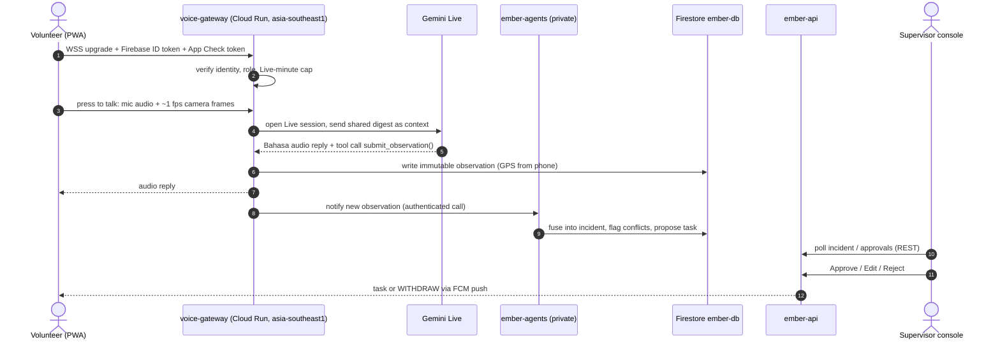

# EMBER: Many eyes, one fire

**A Bahasa-first voice and camera AI fire commander for village volunteer firefighters in Sumatra and Kalimantan. Several volunteers' phones feed one shared incident, and a human supervisor approves every high-stakes call.**


> Built for the **Google Cloud AI Builder Cup 2026**.
> **Status (18 Oct 2026):** the application includes volunteer reporting and tasks, a supervisor console, Gemini voice assistance, and supervisor-initiated LiveKit calls with shared transcription. The latest call and media-upload changes are implemented; deployment configuration and two-device verification are described in the [call runbook](docs/demo/livekit-test.md). Infrastructure changes go through Terraform and the deployment pipelines. Older diagrams show the original design; the text below describes the added call path.

---

## Demo

| | Link |
|---|---|
| Live app | **TODO:** `https://ember-fire-commander.web.app` (goes live once the web app is deployed) |
| Demo video (< 3 min) | **TODO:** add link |
| Pitch deck (PDF) | **TODO:** add link (`docs/EMBER-deck.pdf`) |

---

## 30-second pitch

Village fire brigades in Indonesia's peatlands are unpaid volunteers on motorbikes. Each day they see thousands of satellite hotspots, and they can only reach a handful. EMBER gives each volunteer a hands-free, Bahasa-speaking "komandan" on their phone. They talk, show the fire on camera, and get guidance back. Reports from many phones are fused into **one incident picture** for a supervisor, who verifies, resolves conflicts and approves dispatch. The rule that tells volunteers to withdraw is written in code, not left to the model, and it never waits for approval.

EMBER helps scarce brigades decide **where to look first**. It does **not** forecast fire spread or haze, and it does not stop haze.

## The problem

- About **202,000 ha burned in Indonesia from January to July 2026**, with West Kalimantan worst hit (more than 38,000 ha). The forestry minister said the fires could last until early November. ([Reuters, Sep 2026](https://www.reuters.com/investigates/special-report/asia-weather-indonesia-wildfire-women/))
- Groups like **the Power of Mama**, more than 140 women patrolling 10 villages in Ketapang, West Kalimantan, work unpaid on motorbikes. They record hotspots and put out fires. Their NGO partner does not let them handle big fires, and peat fires "smoulder underground" and come back. (same Reuters report)
- NASA FIRMS satellite hotspots are thermal anomalies, not confirmed fires, and NASA says FIRMS is not meant for tactical decisions. Someone on the ground has to verify them, and there are few volunteers to do it.

## How it works

1. **Leads:** every hour, NASA FIRMS hotspots and weather are pulled in and each hotspot is given an explainable 0–100 *spread-risk* score with its reasons shown (for example "8 dry days · RH 39% · wind 10 km/h · 62% peat"). These are **leads to verify**, never "fires". *(planned)*
2. **Report:** volunteers submit quick chips (*asap*, *api*, *aman*, *butuh bantuan*), notes, up to four photos and one video from either Report or Task. Camera capture and gallery selection share the same form; submitted reports use an offline outbox and retain task context. [Report media guide](docs/demo/report-uploads.md).
3. **Fuse:** the agents service processes observations into shared incidents with deterministic fusion and conflict rules, evidence scores, and advisory summaries. Implementation lives in `services/agents/`.
4. **Conflicts are surfaced:** if volunteers disagree ("small flame" vs "no flame"), EMBER flags it, shows both side by side and holds dispatch. It never averages the reports. *(planned)*
5. **Human approves:** the supervisor console shows the shared picture, a verification queue, wind and an *indicative* downwind exposure corridor. The supervisor approves, edits or rejects each proposal. Only a human can mark an incident verified or extinguished, or lower its severity. *(planned)*
6. **Safety first:** deterministic rules in code (not model output) send **WITHDRAW upwind** on large flames or high wind, immediately and logged. *(planned)*
7. **Re-ignition watch:** extinguished sites are remembered, and new detections near them raise a re-inspection alert. *(planned)*

## Architecture


Editable source: [`docs/architecture/ember_infra_v2.drawio`](docs/architecture/ember_infra_v2.drawio). Details: [`docs/architecture/architecture.md`](docs/architecture/architecture.md).

**Backend-mediated data access.** The browser uses authenticated backend endpoints for application state, Gemini, and signed media URLs. The media paths are:
1. Photos and recorded videos: direct HTTPS transfers to Cloud Storage using short-lived **signed URLs** issued by `ember-api`.
2. Gemini voice assistance and call transcription: **WSS** connections to `voice-gateway`, which holds the Gemini sessions.
3. Human calls: browser camera/microphone media through **LiveKit**, using room-scoped participant tokens issued by `ember-api`. LiveKit credentials stay on the API server.

The browser never opens Firestore listeners and never calls Gemini or the Maps/Weather data APIs directly. The map tiles are the only Maps call from the browser, using a referrer-restricted key.

| Component | Runs on | What it does |
|---|---|---|
| Volunteer PWA + supervisor console | Firebase Hosting | One React/Vite web app with role-based routes. Push-to-talk, camera, chips, task cards, WITHDRAW screen, shared map |
| `ember-api` (public) | Cloud Run | REST: identity, incidents, tasks, approvals, signed media URLs, FCM, audit, call lifecycle, scoped LiveKit tokens and snapshots |
| `voice-gateway` (public, WSS) | Cloud Run | Gemini voice assistance and authenticated call transcription, usage caps, shared transcript delivery |
| LiveKit Cloud | LiveKit | Volunteer video and two-way call audio; supervisor publishes audio only |
| `ember-agents` (private) | Cloud Run | ADK agent graph: intake, dedupe/cluster, fusion, conflict, scoring, plan. Only `ember-api` and `voice-gateway` can call it |
| `ember-ingest` *(planned)* | Cloud Run job + Scheduler | Hourly FIRMS, weather and PSI pulls |
| Firestore `ember-db` | Firestore Native | Shared incident state. Client access denied, so only the backend reads and writes it |
| Media bucket | Cloud Storage | Private photos, incident snapshots and recorded clips; photos expire after 14 days and videos after 7 days |

### Supervisor-to-volunteer calls

The supervisor opens a volunteer's incident popup and selects **Request live video**. The volunteer receives a push or foreground invitation and chooses **Join** or **Decline**. Requests expire after 45 seconds. Once accepted, LiveKit carries volunteer video and two-way audio; both participants can mute, and closing the supervisor popup asks to end the call.

Each participant's unmuted local microphone also reaches Gemini through `/calls/transcription`. The gateway writes one ordered transcript history with call ID, speaker identity, segment ID, sequence and timestamps. Both screens replay the same history. Ember AI receives bounded recent transcript context and optional sampled-frame descriptions; suggestions and written messages reach the volunteer only when the supervisor sends them. Live media is not recorded automatically; explicit snapshots are saved to the incident.

For hackathon testing, a signed-in volunteer can claim a pending `CALL-XXXX-XXXX` code through **Profile → Test Connectivity**. The first volunteer to join claims it. The separate console test is under the header profile menu. See the [call setup and test guide](docs/demo/livekit-test.md) and [API map](docs/api/api-map.md).

### Live voice and video path

Relay through `voice-gateway` is the **default**. A direct phone-to-Gemini connection with an ephemeral token is only a **fallback** (Preview), used if the latency test from Singapore shows the relay is too slow.



## How we use Gemini and Google Cloud AI

| Model / tool | Used for | Status |
|---|---|---|
| **Gemini Live** (`LIVE_MODEL`) | Voice assistance through reporting tools and separate transcription-only sessions for each call speaker | implemented |
| **Gemini Flash** (`agents_flash_model`) | Photo triage, incident summaries, advisory suggestions and sampled call-frame descriptions | implemented |
| **ADK (Agent Development Kit)** | The agent graph in `ember-agents`, with a human-in-the-loop pause for supervisor approval | in progress |
| **Agent Platform Evals** | Scenario tests with simulated volunteers as a quality gate | planned |
| **Agent Platform Memory Bank** | Remembering landmarks and language preference, with consent | optional / planned |

Design principle: **the deterministic code decides and Gemini talks and looks.** Distances, wind, scores and safety rules come from code and data, and every number spoken or shown comes from a tool or database value. Gemini is called through **Agent Platform** with service-account auth, so no Gemini API key is used on the default path.

## Google Cloud services

| Service | Why we use it | Status |
|---|---|---|
| Cloud Run (`ember-api`, `voice-gateway`, `ember-agents`) | Serverless containers with WebSocket support and scale to zero | **live**; deploy latest images for new features |
| Firestore (Native, `ember-db`) | Shared incident state. Point-in-time recovery and daily backups are on | **live** |
| Cloud Storage | Private photo bucket: uniform access, public access prevention, 14-day lifecycle, soft delete, signed-URL uploads | **live** |
| Secret Manager | FIRMS, data.gov.sg, Maps and API-only LiveKit credentials | **live**; new LiveKit wiring requires apply and populated values |
| Artifact Registry (`ember`) | Container images, with a cleanup policy | **live** |
| IAM | One least-privilege service account per service | **live** |
| Firebase Hosting | Serves the PWA and console over a global CDN | **live** (web app not deployed yet) |
| Firebase Authentication | Google sign-in. Phone/SMS sign-in is deliberately off | **live** |
| Firebase App Check | reCAPTCHA Enterprise (Fraud Defense) attestation, 6 h token TTL. Not enforced until the demo | **live** (registered) |
| Firebase Cloud Messaging | Task and WITHDRAW push | **live** (key generated) |
| Maps JavaScript API | Map for the console and the volunteer mini-map, with a referrer- and API-restricted browser key | **live** (key and Map ID) |
| Maps Weather API | Wind, humidity and rain at an incident, fetched by `ember-api` with a Weather-only server key | **live** (key) |
| Cloud Billing budgets | Budget alert emails | **live** |
| Gemini on Agent Platform | Live, Flash, ADK, Evals (see above) | in progress |
| Cloud Scheduler, BigQuery | Hourly ingest and archive / back-test tables | planned |

## Security and responsible AI

- **Backend-mediated:** client Firestore and Storage rules are *deny-all*. Data reaches the browser only through authenticated backend endpoints.
- **ID tokens and App Check:** protected API routes verify Firebase identity and role. Gateway browser upgrades consume one-use API-issued voice tickets; native upgrades verify token headers. App Check follows `APP_CHECK_ENFORCE`. LiveKit tokens are scoped to a room and authorized participant; transcript access is checked separately against call membership.
- **Least privilege:** one service account per service. `ember-agents` is private and only `ember-api` and `voice-gateway` can invoke it. Secrets are scoped per accessor.
- **Keyless CI/CD:** GitHub Actions authenticates with Workload Identity Federation, so no JSON keys are stored in the repo.
- **Human in the loop:** dispatch always needs supervisor approval. Only a human can verify or extinguish an incident or lower its severity. WITHDRAW is a hard-coded safety rule, not a model output.
- **Honest data use:** FIRMS hotspots are leads to verify, never "fires". Exposure corridors are labelled *indicative, not a forecast*.
- **Synthetic data:** development and the demo use simulated volunteers and personas. No real volunteer data is used, and we claim no endorsement by any NGO or agency.
- **Privacy:** no faces in photos, photos deleted after 14 days, and volunteers can opt out of sharing their location with their crew.

### Limitations

- EMBER does **not** forecast fire spread or smoke plumes.
- The risk score is hand-weighted and is not a probability. Its back-test will be published, including the cases where it does not beat simple baselines.
- Dedupe and conflict thresholds were tuned on **synthetic** GPS-noise models, not field data. Practitioners need to tune them.
- PWA limits: no reliable background GPS or audio, and iOS web push needs a Home-Screen install (iOS 16.4+).
- Gemini Live runs outside Asia (there is no Asia endpoint), so voice has a cross-region hop. Latency will be measured from Singapore.
- Bahasa prompts and UI text need review by a native speaker.

## Infrastructure as code and CI/CD

Google Cloud infrastructure is defined in **Terraform** under [`infra/`](infra/README.md). LiveKit Cloud is configured separately. Terraform owns the API's LiveKit URL and secret references; secret values are populated separately in Secret Manager.

For the new LiveKit wiring, first apply with `livekit_url = ""` to create `LIVEKIT_API_KEY` and `LIVEKIT_API_SECRET`. Add enabled secret versions, then set the actual `wss://` URL in `infra/terraform/terraform.tfvars` and apply again. Only `ember-api` can read these secrets. This configuration is separate from local `.env` values and optional connectivity-test flags.

- **Remote state** in a private, versioned GCS bucket (`gs://ember-fire-commander-tfstate`) with native locking. State is not kept in Git.
- **Pipeline-owned:** infrastructure changes go through a pull request. `terraform plan` runs on every PR, and `apply` runs from `main` only after approval in the `production` environment. GitHub Actions authenticates with **Workload Identity Federation** as `sa-ember-terraform`, with no JSON keys.
- **App deploy pipelines** (`.github/workflows/deploy-*.yml`, with Cloud Build alternatives in `infra/pipelines/`) build images into Artifact Registry and deploy each Cloud Run service as its own runtime service account. Terraform ignores the image, so pipelines own the code and Terraform owns everything else.

### What is NOT managed by Terraform

These are deliberately done by hand or are one-time console settings:

| Item | Why |
|---|---|
| Firebase Auth sign-in providers (Google) | Console setting |
| App Check app registration and reCAPTCHA (Fraud Defense) key | Console setting (optional Terraform flag exists) |
| FCM Web Push (VAPID) key pair | Generated in the Firebase console only |
| Maps Map ID | Created in Map management |
| Maps daily quotas | The free trial blocks quota changes. To be set after upgrading |
| Maps API keys | Kept out of Terraform so the key strings never land in state |
| Secret **values** | Added with `gcloud secrets versions add` so they never enter state |
| Removing Editor from the default compute service account | One-off cleanup command |
| Project Owner binding | Kept outside Terraform so it can't lock us out |
| Budget alerts | Only if `enable_budget` is off |
| The Terraform state bucket | Must exist before `terraform init` |

## Cost

From our cost model (prices checked 3–6 Oct 2026, 16 days, 4 developers, one project). *The cost model document (`ember_cost_estimate.md`) is **not yet in this repository**; the figures below are its summary.*

| Scenario | Estimate (USD) |
|---|---|
| Managed plan (dev on synthetic data, pay mainly for demo takes and evals) | ≈ $12 |
| Low | ≈ $29 |
| Expected | ≈ $192 |
| High (everything goes wrong) | ≈ $1,338 |

Gemini Live is the biggest cost driver, because each turn re-bills the accumulated context. Push-to-talk bursts cost about **$0.093 per volunteer-hour (8 bursts)**, compared with about **$4.42** for an always-open mic, roughly 47× cheaper. Other guardrails: per-user Live-minute caps, budget alerts, and Cloud Run min 0 / max 3 instances. All figures are estimates, not measured spend.

## Repository layout

```
.
├── apps/web/                 # React + Vite + TypeScript PWA – Google sign-in, role routes (/pwa volunteer, /console supervisor), in progress
├── services/
│   ├── api/                  # Flask REST: identity, incidents/tasks, media, notifications, calls and LiveKit tokens
│   ├── voice-gateway/        # Gemini voice assistance and shared call transcription over WSS
│   └── agents/               # Incident processing, photo triage, advisory AI and call-frame descriptions
├── jobs/ingest/              # hourly FIRMS / weather / PSI job – planned
├── infra/
│   ├── terraform/            # all GCP + Firebase resources, GCS backend
│   ├── pipelines/            # Cloud Build configs
│   └── README.md             # infra runbook
├── .github/workflows/        # terraform.yml + deploy-*.yml
├── docs/contracts/           # shared-contract.md: REST, WebSocket, entities, errors (source of truth)
├── docs/api/                 # api-map.md: route lookup, who calls each one
├── docs/architecture/        # ember_infra_v2.png/.drawio, ember_infra_simple_data_paths.png, architecture.md
├── LICENSE                   # Apache-2.0
└── README.md
```

## Local setup

> The application code is in progress. Commands marked TODO will be confirmed once each service exists.

Prerequisites: Node.js 20+, Python 3.11+, the Google Cloud SDK (`gcloud`), the Firebase CLI, and optionally Docker.

```bash
git clone https://github.com/suhail39ahmed/ember-fire-commander.git
cd ember-fire-commander
gcloud auth application-default login
gcloud config set project ember-fire-commander

# Web app
cd apps/web && cp .env.example .env.local   # Firebase config, App Check site key, VAPID key, Maps browser key, Map ID, API/gateway URLs
npm install && npm run dev                  # http://localhost:5173

# Backend services (TODO)
# FIRESTORE_DATABASE=ember-db must be set for every service
```

Values in `.env` (the Firebase web config, the reCAPTCHA site key, the restricted Maps browser key) are public by design, but are still kept out of Git. Server secrets live only in Secret Manager. For App Check on localhost, register a debug token in the Firebase console.

For local Google sign-in, open the browser developer console and find the App Check debug token printed when the first account check runs. Register it under Firebase Console → App Check → Apps → the web app's menu → Manage debug tokens. To reuse a registered development token across ports or incognito sessions, set `VITE_FIREBASE_APPCHECK_DEBUG_TOKEN` in `apps/web/.env.local` and restart Vite. Treat this token as a secret and never commit it. This setting is only used in development.

An unregistered debug token causes `appCheck/fetch-status-error` (HTTP 403). Because App Check initializes on the first API account check, the initial Google popup can work while subsequent sign-ins fail before opening a popup. Refreshing temporarily resets that initialization; registering the debug token fixes the configuration. Do not disable App Check enforcement to work around it. See the [Firebase debug-provider setup](https://firebase.google.com/docs/app-check/web/debug-provider).

## Roadmap

- Native app (**React Native**) for reliable background GPS and audio
- Offline voice: record a short clip and transcribe it with Flash when back online
- Google Earth Engine peat and burn-history layers in the risk score
- Agency report drafts (BPBD / Manggala Agni) for the supervisor to send outside EMBER
- Field tuning of thresholds with practitioners, and a native-speaker review of all Bahasa text

## Team

| Name | Role |
|---|---|
| Suhail Ahmed | Solution Architect, AI & Automation |
| Md Naushad ([@MdNaushad](https://github.com/MdNaushad)) | Lead Software Engineer |
| Zeeshan ([@zeeshrocky](https://github.com/zeeshrocky)) | UI/UX Designer |
| Aqib Pasha | Salesforce Solution Architect |

## License

[Apache-2.0](LICENSE)

## Acknowledgements and attributions

- **NASA FIRMS:** "We acknowledge the use of data and/or imagery from NASA's Fire Information for Resource Management System (FIRMS) (https://earthdata.nasa.gov/firms), part of NASA's Earth Science Data and Information System (ESDIS)." FIRMS data is not intended for tactical decision-making.
- **Open-Meteo:** weather data by [Open-Meteo.com](https://open-meteo.com/), licensed under [CC BY 4.0](https://creativecommons.org/licenses/by/4.0/).
- **data.gov.sg:** Singapore PSI data from data.gov.sg, under the Singapore Open Data Licence.
- **Google Maps Platform:** maps and Weather API, used under the Google Maps Platform terms.
- **LiveKit:** [LiveKit](https://livekit.io/) and its client/server SDKs provide real-time video and audio for supervisor–volunteer calls. Gemini provides speech transcription through our gateway.
- Inspired by Reuters' reporting on the Power of Mama volunteer brigade (Sep 2026). The personas in our demo are simulated, and EMBER is not affiliated with or endorsed by any organisation mentioned.
